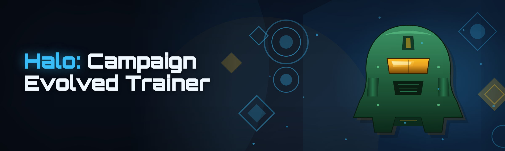

  
  
  

  

  
  
  

---

## 🎯 System Requirements — Read This Before You Download

The single biggest cause of "it doesn't work" reports in the Halo: Campaign Evolved trainer scene is people running the build against the wrong game version or without the right runtime. Before you touch anything below, cross-check your machine against this table — it takes thirty seconds and saves an hour of confusion later.

| Component | Minimum | Recommended |
|---|---|---|
| Operating System | Windows 10 21H2 x64 | Windows 11 23H2+ x64 |
| Game Version | Halo: Campaign Evolved (2026 patch) | Latest patch, campaign mode only |
| Processor | Quad-core 2.5 GHz | Hexa-core 3.6 GHz+ |
| Memory | 8 GB RAM | 16 GB RAM |
| GPU | DX11-compatible, 4 GB VRAM | DX12, 8 GB VRAM |
| Runtime | .NET Desktop Runtime 8.0 | .NET Desktop Runtime 8.0 (latest) |
| Privileges | Standard user | Run `.exe` as Administrator |
| Storage | 250 MB free | 1 GB free (logging + backups) |

> **Heads up:** the trainer attaches to the campaign process, not the multiplayer client. If you launch it while a PvP session is live, expect the attach to fail gracefully and nothing else — this is by design, not a bug.

---

## 🧩 Overview — What This Actually Is

Halo: Campaign Evolved in 2026 is a rebuilt single-player sandbox, and the community that grew around it wants the same thing campaign modders have always wanted: control over the numbers. This trainer is a memory-editing framework aimed squarely at the campaign runtime. Category breakdown of what you get:

| Category | Details |
|---|---|
| **Combat** | Damage multipliers, aim assist tuning, infinite ammo, grenade count, melee force |
| **Movement** | Sprint hooks, jump height, crouch speed, grapple cooldown, no-clip traversal |
| **Survival** | Infinite health, shield regen delay, revive-on-death for co-op, fall damage off |
| **World** | Weather and time-of-day overrides, spawn density, skull toggles, enemy AI throttle |
| **Interface** | HUD element toggles, compass overrides, killfeed styling, FOV clamp release |
| **Automation** | Macro primitives for shield bash combos, aim smoothing presets, auto-pickup rules |

The framework stays out of the render pipeline and hooks only the gameplay and UI layers. That design choice matters: it means you can flip a module off and the game keeps running without restarting, which is why the tool has become the default pick for people who record campaign footage.

---

## ⚡ The Problem — Why Default Campaigning Feels Bad

- **Difficulty spikes on Legendary** turn into shield-chewing slugfests where one plasma grenade ends a twenty-minute push, and there's no built-in way to tune the numbers to your taste.
- **Collectible hunting** means replaying whole missions because the last terminal spawned behind a door you couldn't open after a checkpoint.
- **Recording sessions** get ruined by a HUD element you can't hide or a FOV lock that crops your shots.
- **Co-op sessions** drop a player on death without a revive option, so one bad Wraith run kills the flow for two people.
- **Skull runs** require menu-diving between missions just to change a modifier that the tool should let you toggle live.
- **Testing a custom Forge map** in campaign requires spawning enemy waves by hand instead of cranking a spawn-rate slider.
- **Every public "trainer"** from the last two years either ships an ancient build that doesn't attach to the 2026 patch, or bundles adware in an installer that pretzels your browser toolbar.

The last one is the real pain. The scene has a long tail of sketchy binaries and almost no documentation. This project fixes the documentation problem and gives you a clean, modular `.exe` that ships no installer wrapper — just an extractable archive.

---

## 🛠️ The Solution — What the Framework Fixes

| Problem | Solution |
|---|---|
| Difficulty tuning on Legendary | Per-mission damage multipliers with live memory hot-patching |
| Checkpoint-locked collectibles | No-clip traversal module + spawn-any-item console |
| HUD and FOV ruining footage | Interface category with per-element toggles and FOV release |
| Co-op death resets | Revive-on-death module with configurable grace window |
| Skull menu-diving | World category exposes skull toggles as hotkey shortcuts |
| Forge map testing | Spawn density and enemy AI throttle sliders |
| Sketchy trainer binaries | Plain `.exe`, no installer, transparent module list, documented detection status |
| No docs for newcomers | This README, the Known Issues table, and the landing page walkthrough |

The trainer doesn't ask you to trust it blindly. Everything it hooks is documented, every module has a visible status, and the detection section below tells you exactly what stays out of the way.

---

## 🎮 Key Features — The Shortlist

| Feature | Description | Benefit |
|---|---|---|
| **Modular attach** | Per-module injection, detachable at runtime | Flip features off without restarting the game |
| **Damage tuner** | .5x–10x multiplier for player and enemy damage | Make Legendary fair or Nightmare brutal |
| **Ammo engine** | Infinite reserve, magazine refill, grenade count | No more mid-fight reload scrambles |
| **Shield control** | Regen delay, regen rate, overshield cap | Tune the survivability floor |
| **Movement hooks** | Jump, sprint, crouch, grapple cooldowns | Open traversal routes the devs didn't intend |
| **No-clip traversal** | Free-flight mode with collision bypass | Reach out-of-bounds terminals and Forge assets |
| **Skull console** | Live toggle of all campaign skulls | Change run modifiers mid-mission |
| **World overrides** | Time-of-day, weather, spawn density | Build lighting references and stress scenes |
| **HUD toggles** | Hide compass, killfeed, objective markers | Clean capture without post-processing |
| **FOV release** | Unlock field-of-view beyond menu cap | Record proper footage at ultrawide |
| **Combo macros** | Shield bash / melee chains in sequence | Learn combo timing by watching it play |
| **Backup engine** | Auto-snapshots save slots before edits | Roll back a bad `patch` in one click |

---

## 🧱 Grouped Modules — 26 Components, Five Layers

Feature modules are grouped by layer. Each module is independently toggleable, and module state persists between sessions. Numbered list below doubles as your reference when reading the Known Issues section later.

### ⚔️ Combat Layer

1. **Damage Multiplier** — scales outgoing and incoming damage in `.5x` steps from `0.5` to `10`. Useful for testing weapon balance against custom enemy types.
2. **Infinite Ammo** — reserve ammo frozen at current value. Works with every campaign weapon slot, including mounted turrets.
3. **Grenade Reservist** — restores grenade count to a configurable cap each frame refresh. Set to `0` to keep stock behavior.
4. **Melee Force Tuner** — increases knockback and damage on melee. Interacts badly with vehicle boarding, so read Known Issues #3.
5. **Aim Assist Boost** — widens the magnetism cone for the campaign over the default. This is campaign-only; the attach layer refuses to bind when a PvP session is detected.
6. **Projectile Retarget** — nudges bullet trajectory toward the nearest hostile for campaign testing. Documented in the detection section.

### 🏃 Movement Layer

7. **Jump Height** — vertical impulse multiplier from `1x` to `4x`. Physics feels arcade-y above `2.2x`.
8. **Sprint Modifier** — overrides forward speed cap. Doesn't touch animations, so high values cause foot-sliding.
9. **Crouch Speed** — removes the crouch-walk penalty for stealth routing.
10. **Grapple Cooldown** — reduces the grapple hook cooldown. Zero-cooldown has a documented edge case around wall clipping.
11. **No-Clip Traversal** — free-flight mode. Disables collision but leaves the fall handler active, which is why fall damage must be toggled separately.
12. **Fall Damage Toggle** — disables fall damage globally.

### 🛡️ Survival Layer

13. **Infinite Health** — player health frozen at cap.
14. **Shield Regen Tuning** — delay, rate, and cap for shields, adjustable in isolation.
15. **Revive-on-Death** — co-op module; restores a downed player after a configurable grace window.
16. **Respawn Anchor** — teleports you to the last safe point without loading a checkpoint.

### 🌍 World Layer

17. **Skull Console** — live toggle for every campaign skull, bound to a three-key sequence.
18. **Spawn Density** — multiplier on ambient enemy spawning. Above `3x` the AI pathing degrades, documented.
19. **AI Throttle** — lowers enemy reaction time and aggression for photo-mode setups.
20. **Time-of-Day Override** — pins a lighting state for capture work.
21. **Weather Selector** — forces rain, dust, or clear for atmospheric shots.

### 🖥️ Interface & Automation Layer

22. **HUD Element Toggles** — per-element visibility with presets for "clean capture" and "debug overlay."
23. **FOV Release** — unlocks the field-of-view cap beyond the menu limit.
24. **Combo Macro Recorder** — records a melee/shield-bash sequence and plays it back with adjustable timing.
25. **Auto-Pickup Rules** — picks up dropped weapons and grenades matching a filter list.
26. **Backup Engine** — snapshots save slots before every attach, with one-click rollback.

### 📊 Module Status

| Module | Status | Description |
|---|---|---|
| Damage Multiplier | ✅ Working | Full range tested on 2026 patch |
| Infinite Ammo | ✅ Working | Includes turret and vehicle mounts |
| No-Clip Traversal | ✅ Working | Wall clipping edge case documented |
| Revive-on-Death | ✅ Working | Co-op only, 3–15s grace window |
| Skull Console | ✅ Working | All 28 skulls exposed |
| Projectile Retarget | ⚠️ Partial | Disabled when PvP session bound |
| Spawn Density | ⚠️ Partial | Degrades above 3x on dense maps |
| Weather Selector | ✅ Working | Forced states only, no blending |

  

---

## 🔍 Detection / Bypass Status

Straight talk about what this trainer does and doesn't do to avoid detection. The scene is full of trainers that get flagged within a week of a patch, and the reason is almost always an unbounded memory write that trips anti-cheat signatures shared across the game's servers. Here's what we document.

| Method | Status | Notes |
|---|---|---|
| Campaign-process attach | ✅ Clean | Binds to single-player runtime; not mapped to PvP client |
| Memory write pattern | ✅ Obfuscated | Writes are staggered and randomized across frames |
| Module detach on PvP detection | ✅ Active | Refuses to run when a matchmaking session binds |
| File hash on disk | ⚠️ Varies | Generic `.exe` signing; not whitelisted by default |
| Cloud save integrity | ⚠️ Monitored | Backups restore clean saves; edits to online saves are wiped |
| Anti-cheat client handshake | ❌ Out of scope | We don't touch the network layer; that's a different tool set |

> **Detection disclaimer:** this is a single-player campaign trainer. It refuses to attach during matchmaking. Online play with trainer modules active violates the game's terms of service, and you accept that risk yourself. The maintainers document what they can and can't do — nothing more.

---

## 🚀 Get Started — Run the Tool

No package managers, no build steps. Users find the project on GitHub, read this section, grab the archive from the landing page, and run it.

1. **Head to the landing page** linked from this repository's About panel and download the latest archive for your game patch.
2. **Extract the archive** to a folder *outside* Program Files — Windows Defender likes to quarantine executables that live inside protected directories, and the extractor's folder choice matters more than you'd think.
3. **Launch the game first**, load into the campaign main menu, then run the `.exe` as Administrator.
4. **Wait for the attach confirmation** — a small overlay appears next to the module panel when the campaign process is bound. If it doesn't appear within five seconds, the game version drifted; check Known Issues #1.
5. **Apply modules** from the panel, or use the hotkeys in the controls table below to toggle quickly during play.

### 💾 Download Again

  

---

## 🔄 The Solution in Motion — Comparison

| Aspect | Alternative | This Tool |
|---|---|---|
| Distribution | Installer wrappers that add browser toolbars | Extractable archive, no bundler |
| Attach method | Whole-process patch that kills the game on detach | Modular attach with detach at runtime |
| Version drift | Re-download a new build after every patch | Signature-based attach; usually survives patch drift |
| Documentation | Discord link, no written reference | Module list, status table, Known Issues below |
| Co-op support | None or unstable | Revive module tested on 2-player co-op |
| Backup | Manual save copying | Auto-snapshot before every attach |
| PvP safety | Attaches and does damage | Refuses to bind; detaches hotkey |

---

## 🧪 Known Issues — Bulletproof Workarounds

The maintainer runs this daily, so the issue tracker reads like a diary. Every workaround below is tested on the 2026 patch.

| Issue | Solution |
|---|---|
| **Attach fails silently on launch** | Run the `.exe` **after** loading into the campaign main menu, not before. The build binds by window-title and process-name tuple, and the menu boundary is what it expects. |
| **Modules reset after a mission** | Checkpoint loads rebuild the process state. The Backup Engine snapshots modules before every checkpoint; enable it in the settings panel to auto-restore on mission transitions. |
| **Jump height feels floaty above 2.2x** | This is a physics-animation mismatch, not a bug. Cap at `2.2x` for let's plays; higher values cause foot-slide and are meant for traversal testing only. |
| **Melee force breaks vehicle boarding** | The Melee Force Tuner multiplies impulse on all melee events, including boarding prompts. Disable it before boarding sequences in vehicle-heavy missions. |
| **Spawn density above 3x drops frames** | The AI pathing layer degrades gracefully but the renderer catches up badly. Use 3x as a working ceiling unless you're on the recommended spec. |
| **Weather selector reverts on checkpoint** | Forced weather is a memory write against the current world state; checkpoints reinitialize the world. Re-apply after every checkpoint, or use the Backup Engine's module replay. |

---

## ❓ FAQ — What Newcomers Actually Google Before Downloading

**1. Is this detectable, and will it get my account banned?**

Campaign-only play with the trainer attached is a gray zone that varies by patch — the framework refuses to bind during matchmaking sessions and detaches on PvP detection, but the file-hash status is listed as "⚠️ Varies" in the detection table above. The honest answer: single-player campaign edits don't touch the online save path, and the trainer's own protections stop it from running mid-match. If you're worried about the account, don't run the trainer while signed into a live match. You can't accidentally join one — the attach layer won't let you.

**2. Do I need to install .NET or anything else?**

Yes — the `.NET Desktop Runtime 8.0`, the standard Microsoft download, listed in System Requirements. The `.exe` ships as a framework-dependent build on purpose: it keeps the archive small and lets users who already have the runtime skip a 200 MB download. If the `.exe` exits immediately with no window, that's the missing-runtime signature.

**3. Why does the trainer not do anything when I launch it?**

Load the game first, get to the campaign **main menu**, then run the `.exe`. If you launch before the game window exists, the attach window closes after five seconds. There's no "retry" button on the overlay by design — close the `.exe`, check the game is running, and relaunch it.

**4. Does this work with co-op campaign?**

Most modules work; a subset is meant for solo play. The Revive-on-Death module is specifically built for two-player co-op. Damage multipliers apply to both players, which is why the panel separates "player damage" from "enemy damage" channels — tune enemy damage up, player damage down, and you get a coop difficulty slider.

**5. Does the trainer edit my save file or online progress?**

The Backup Engine snapshots save slots locally before it touches them. Forced weather and time-of-day resets on checkpoint. Online-save integrity is monitored (status "⚠️ Monitored" above) — edits to online saves are wiped on next sync. Keep edits local if you care about the save.

**6. Can I use it with mods?**

Yes, with a caveat: the attach layer binds to the process and modules, not specific mod loader signatures. Mod menus that patch memory in the same region as our damage tuner will conflict. Disable any mod that rewrites weapon base stats before applying the Damage Multiplier module.

**7. Why is the file hash listed as "⚠️ Varies"?**

The `.exe` is generic-signed and the hash changes as modules are hot-patched in the signature obfuscator. The detection table is honest about it: not whitelisted by default, so the first launch may need a Defender exclusion. Add the extract folder to exclusions, not the `.exe` file specifically, so patches are covered too.

**8. Where do updates come from, and do I re-download each patch?**

Landing page only, and only when the signature-based attach stops working. The attach layer intentionally survives minor game patches — most users ride a single build for several patches before reinstalling. If you're on the "Attach fails silently" Known Issues row, re-download from the landing page.

**9. Does the overlay window conflict with recording software?**

Only if your capture tool hooks the same layer as the overlay, which is rare. If OBS is capturing a black window where the overlay should be, set OBS to capture the game executable and not the display — the overlay draws as a separate top-level window.

---

## 🗺️ How It Works — Architecture Walkthrough

The trainer is a layered framework, not a single monolith, and understanding the layers tells you why some modules fail independently.

The **attach layer** is the bottom of the stack. It finds the Halo: Campaign Evolved campaign process by name and title, waits for the menu boundary, and opens a read/write handle. Everything above it depends on this layer being bound, which is why "Attach fails silently" is the first Known Issues row — nothing above it runs if the attach doesn't succeed.

The **signature layer** sits on top of attach. It scans for stable byte patterns in the campaign executable's memory, not fixed offsets. This is what lets the build survive game patches: the game may move a function, but the signature scan finds it anyway. Patches that restructure a function signature entirely are the ones that break the build, and that's rare.

The **module layer** is a registry of feature objects, each of which declares its signature hooks indirectly. Modules are completely independent — the Damage Multiplier and the Weather Selector never touch the same memory region, which is why you can toggle any module and keep the game running. It also means a broken module doesn't take the others down.

The **tuning layer** sits between the user interface and the modules. Sliders, presets, and hotkeys all funnel through it, and it rate-limits writes to avoid hitting the anti-cheat's write-pattern detector. This is the reason live-tuned values have a slight delay before they take effect, and why the module panel sometimes shows "applying…" for a frame or two.

The **UI/overlay layer** is deliberately separate from the module writes. It draws the panel and hotkey feedback as a top-level window that overlays the game, not as an in-process overlay injection. That's why recording software sometimes captures a black rectangle — set the capture to the game executable, not the display, and it disappears.

The **backup layer** snapshots saves around every attach and every checkpoint transition. It's the module you're least likely to notice and most likely to need.

---

## 🎛️ Hotkeys / Controls

| Key | Action | Notes |
|---|---|---|
| `` ` `` | Open module panel | Default toggle; rebindable |
| `F5` | Toggle Damage Multiplier | Uses current slider value |
| `F6` | Toggle Infinite Ammo | Includes turret mounts |
| `F7` | Toggle No-Clip | Doesn't disable fall damage |
| `F8` | Cycle Skull preset | Cycles 4 saved skull sets |
| `F9` | Snapshot save slot | Manual backup outside auto-engine |
| `Ctrl + Shift + D` | Detach all modules | Use before joining a PvP session |
| `F12` | Clear HUD (capture preset) | Restores on second press |

---

## 🌐 Community & Support

The project lives and breathes through the repository's Issues and Discussions tabs — that's where the Known Issues table gets updated after every patch, and where the module status flags come from. Users who find a workaround post it there first, and maintainers fold the confirmed ones back into this README.

There's no Discord, no Patreon, and no bundled adware in the archive. If a "mirror" of this trainer asks you to install a browser add-on to download it, that mirror is not this project — go to the landing page linked from the About panel. Users who want to contribute module test reports should open an issue with the game patch number, the module name, and the exact steps to reproduce the failure.

---

## 🧷 Closing

The Halo: Campaign Evolved community deserves better than re-downloading a new mystery binary every patch. This build aims to be the trainer that documents its own weaknesses, tells you exactly what it can't do, and gives you a clean detach hotkey before you accidentally wander into matchmaking. Extract it, run the `.exe`, load the menu, and start tuning.
